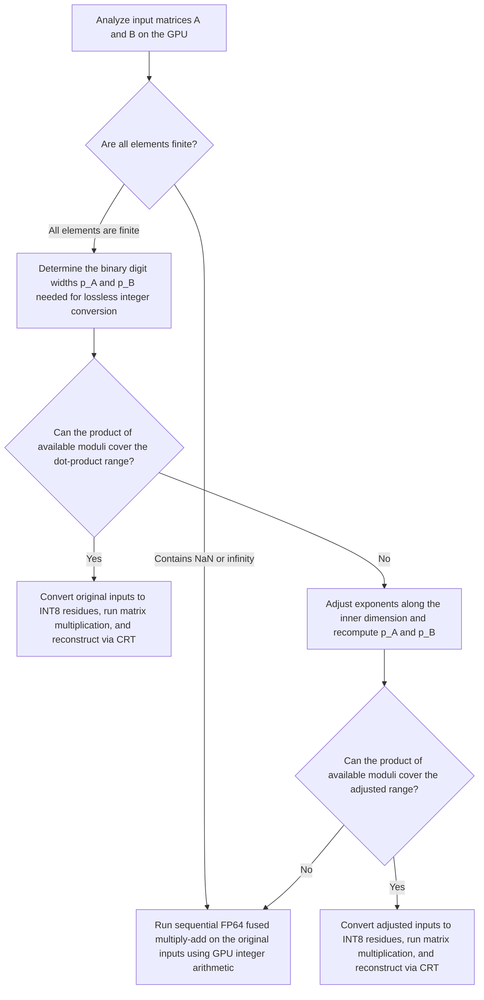

# AppleSilicon-FP64

[日本語](README.md) | English

AppleSilicon-FP64 is a library and experimental command-line tool that computes dense real matrix products $C = AB$ in FP64 (double-precision floating-point) format on Apple Silicon GPUs using Metal.

All numerical operations that depend on the input values run on the GPU. The library first analyzes the exponent ranges of the input matrices on the GPU. When the inputs can be converted to integers without losing any bits, it computes the product using INT8 modular matrix multiplication followed by reconstruction via the Chinese remainder theorem (CRT). CRT uniquely recovers an integer within a known range from its remainders modulo several pairwise coprime divisors, which are referred to as "moduli." Conversely, when the input exponent range is too wide to fit within the CRT range, or when the inputs contain NaNs or infinities, the library computes each dot product on the GPU using FP64 fused multiply-add (FMA) implemented with 128-bit integer arithmetic.

The public API and command-line tool are written in C (C11), while Metal resource management and GPU command dispatch are written in Objective-C. C++ programs can include the same C header and call the functions directly without a wrapper.

## Numerical semantics

The inputs are contiguous, row-major matrices $A$ ($M \times K$) and $B$ ($K \times N$) containing FP64 values. In addition to ordinary finite values, the library supports subnormal numbers, signed zeros, NaNs, and infinities. Empty matrices ($M = 0$ or $N = 0$) and zero-length dot products ($K = 0$) are also accepted. BLAS-style operations involving scaling coefficients or matrix transposition are outside the scope of this library.

The following diagram shows how the library analyzes the input matrices, selects a computation method, and produces the output matrix $\widehat{C}$.



### Determining the required integer widths

Excluding NaNs and infinities, the library inspects the FP64 bit patterns of finite elements to extract their power-of-two exponents. For each row $i$ of $A$ and each column $j$ of $B$, it determines the exponents $h_i$ and $g_j$ that bound the maximum absolute values according to the following formulas. When all elements in a row or column are zero, the exponent for that row or column is set to $0$.

$$
h_i = 1 + \left\lfloor \log_2 \max_k |A_{ik}| \right\rfloor, \qquad
g_j = 1 + \left\lfloor \log_2 \max_k |B_{kj}| \right\rfloor
$$

Next, for finite nonzero elements, let $\ell_i$ be the minimum exponent of the least significant nonzero bit across row $i$ of $A$, and let $t_j$ be the corresponding minimum exponent across column $j$ of $B$. Using the maximum value in each row or column as the reference, the number of binary digits required to represent all elements as integers without truncation is called the "integer width" and is defined as $p_A$ and $p_B$ below. When all elements in a row or column are zero, its required width is $1$. Note that the integer width reflects the spread of exponents across a row or column and differs from the 53-bit significand width of a single FP64 number.

$$
p_A = \max_i \max(1, h_i - \ell_i), \qquad
p_B = \max_j \max(1, g_j - t_j)
$$

### Adjusting exponents along the inner dimension

Even when all elements are finite, the original integer widths $p_A$ and $p_B$ may be too large for the product of the available moduli to cover the dot-product range. However, in each term $A_{ik} B_{kj}$ of the dot product, scaling column $k$ of $A$ and row $k$ of $B$ by opposite powers of two leaves their product unchanged. Therefore, when the original integer widths exceed the capacity of the available moduli, the library adjusts exponents along the inner dimension $k$ and recomputes the integer widths.

Each adjustment $d_k$ is derived from the maximum absolute values in column $k$ of $A$ and row $k$ of $B$. If either column $k$ of $A$ or row $k$ of $B$ consists entirely of zeros, $d_k = 0$. Otherwise, the library computes the exponents $\alpha_k$ and $\beta_k$ and the shift $d_k$ as follows:

$$
\alpha_k = 1 + \left\lfloor \log_2 \max_i |A_{ik}| \right\rfloor, \qquad
\beta_k = 1 + \left\lfloor \log_2 \max_j |B_{kj}| \right\rfloor
$$

$$
d_k = \left\lfloor \frac{\beta_k - \alpha_k}{2} \right\rfloor, \qquad
\widetilde{A}_{ik} = A_{ik} 2^{d_k}, \qquad
\widetilde{B}_{kj} = B_{kj} 2^{-d_k}
$$

Each scaled pair satisfies $\widetilde{A}_{ik} \widetilde{B}_{kj} = A_{ik} B_{kj}$. Rather than rounding $\widetilde{A}_{ik}$ and $\widetilde{B}_{kj}$ back to FP64, the library adds or subtracts $d_k$ directly on the integer exponents and applies the same procedure to recompute the row and column exponents and the integer widths $p_A$ and $p_B$.

### Method selection and rounding rules

If the product of the available moduli can cover the required dot-product range, either for the original inputs or after inner-dimension exponent adjustment, the library uses INT8 matrix multiplication and CRT reconstruction. Converting the inputs to integers does not discard any nonzero bits. Each output element $\widehat{C}_{ij}$ is the exact dot product rounded once to FP64 using round-to-nearest, ties-to-even ($\mathrm{RN}_{64}$). When the exact dot product is zero, the output is positive zero ($+0.0$).

$$
\widehat{C}_{ij} = \mathrm{RN}_{64}\left(\sum_{k=0}^{K-1} A_{ik} B_{kj}\right)
$$

Conversely, if the required integer width still exceeds the product of the moduli after exponent adjustment, or if the inputs contain any NaN or infinity, the library uses the unadjusted inputs and executes FP64 fused multiply-add on the GPU using integer arithmetic. Each dot product starts from $s_0 = +0.0$ and accumulates terms in ascending order of $k = 0, 1, \dots, K-1$. Each step rounds the exact sum of the product and accumulator once to FP64 using round-to-nearest, ties-to-even:

$$
s_{k+1} = \mathrm{RN}_{64}(A_{ik} B_{kj} + s_k), \qquad
\widehat{C}_{ij} = s_K
$$

Both computation methods follow the same rules for subnormal values, overflow, signed zero, and nonfinite results:

- Results in the subnormal range are rounded directly to the FP64 subnormal spacing without intermediate normal rounding.
- Magnitudes that exceed the maximum finite FP64 value overflow to signed infinity.
- A negative nonzero value that underflows to zero produces negative zero ($-0.0$).
- Any fused multiply-add involving a NaN, multiplication of zero by infinity, or addition of infinities with opposite signs returns a quiet NaN with the canonical bit pattern `0x7ff8000000000000`. Input NaN payloads are not preserved, and CPU floating-point exception flags are not modified.

Because the number and order of rounding operations depend on the selected method and differ from CPU BLAS implementations, the library does not guarantee bitwise agreement with `cblas_dgemm`. Likewise, when the sequential FMA path is selected, rounding occurs at every accumulation step rather than once on the exact dot product.

## GPU computation

The table below summarizes the main operations executed on the GPU and how each stage is implemented.

| Operation | GPU implementation |
|---|---|
| Input analysis | Inspect the exponents and least significant nonzero bits of the FP64 bit patterns to determine the required integer widths and whether nonfinite values are present. |
| Conversion to INT8 residues | Construct integer representations from the significands and exponents, then compute their remainders modulo each modulus as signed INT8 values. |
| INT8 matrix multiplication | Execute Metal 4's `mpp::tensor_ops::matmul2d` with INT8 inputs and INT32 accumulation. |
| CRT reconstruction and FP64 rounding | Reconstruct the exact dot product in multi-precision integer arrays from the per-modulus remainders, then round to an FP64 bit pattern. |
| FP64 fused multiply-add | Add or subtract the exact significand product and aligned addend in 128-bit integers, then round each step to an FP64 bit pattern. |

### Input analysis and CPU dispatch

GPU kernels read each 64-bit FP64 input element as two 32-bit unsigned integers. First, the CPU encodes the row analysis of $A$ and the column analysis of $B$ into a single concurrent Metal compute command encoder. During the column analysis of $B$, adjacent threads read adjacent columns to coalesce memory accesses, while multiple SIMD groups divide the work along the inner dimension. Once both analyses complete and a memory barrier makes their writes visible, an aggregation kernel writes the overall integer widths $p_A, p_B$ and a nonfinite flag into a 12-byte result buffer.

If this initial analysis shows that all elements are finite but the integer widths exceed the CRT range, the CPU submits one additional command buffer to perform exponent adjustment. This submission reuses the scale buffers to analyze the columns of $A$ and the rows of $B$, computes the inner-dimension shifts $d_k$ on the GPU, and updates the row and column analysis results using the adjusted exponents. The original FP64 input buffers remain unmodified; the analysis and residue-conversion kernels add or subtract $d_k$ on the integer exponents directly.

The CPU reads only the 12-byte analysis summary from the GPU to select the compute pipeline and allocate workspace buffers. When the CRT path is selected, the CPU prepares reconstruction coefficients and residue lookup tables that depend only on the dimensions and integer widths, never scanning matrix elements or computing dot products on the CPU. After encoding and submitting all GPU work, the CPU waits for GPU completion before returning the output.

### Matrix multiplication using integer residues

#### Selecting moduli and reusing coefficients

Moduli are chosen in descending order from 49 pairwise coprime integers at most 256 (`256, 255, 253, ..., 29`). Including composite moduli allows multiple prime factors to be handled within a single matrix multiplication. The library adds moduli in descending order until their product $P = \prod_t m_t$ satisfies:

$$
P > 2K 2^{p_A + p_B}
$$

The division coefficients for each modulus, the lookup tables of power-of-two residues, and the CRT reconstruction weights depend only on the inner dimension $K$ and the integer widths $p_A$ and $p_B$. Whenever $K$, $p_A$, and $p_B$ match those of the previous call, the multiplier reuses the existing coefficients and runs only the GPU input conversion for the new matrix values.

#### Row batching and conversion to INT8 residues

To bound intermediate memory usage, the residue matrix for $B$ is generated once and retained for the entire call, whereas $A$ and the output $C$ are processed in batches of rows (`batch_rows`).

In the residue-conversion kernel, each FP64 element is unpacked into its significand and exponent only once regardless of the number of moduli. When shifting a significand to the right to align it with the row or column reference exponent, the choice of $p_A$ and $p_B$ guarantees that all shifted-out bits are zero. The power-of-two residues multiplying the high and low words of the significand are fetched from a single table that packs both 8-bit residues into one 16-bit entry. For each modulus, the kernel computes the remainder from the upper 32 bits of a multiplication (`mulhi`) and at most one subtraction, then maps the result into a symmetric signed INT8 residue.

#### INT8 matrix multiplication and dot-product splitting

In the matrix-multiplication kernel, four SIMD groups cooperate on each $64 \times 64$ output tile. When a tile lies entirely within the matrix boundaries and covers a full 1024-term inner chunk, the kernel uses compile-time tensor dimensions; at matrix edges, it uses dynamic runtime dimensions.

Even though Metal's `matmul2d` accumulates into an INT32 output tensor, an execution path that uses FP32 intermediate values can represent integers exactly only up to $2^{24}$. Therefore, rather than assuming exact integer accumulation across arbitrarily long dot products from the INT32 output type alone, the library splits the inner dimension $K$ into chunks of at most 1024 terms so that the sum of absolute term products in each chunk never exceeds $1024 \times 128^2 = 2^{24}$. Splitting the dot product does not alter the exponents used for integer conversion.

- When $K \le 1024$, the library dispatches a single-chunk pipeline that omits partial-sum arrays and accumulation loops.
- When $K > 1024$, the accumulating pipeline adds chunk products in INT32 and reduces the running sum modulo $m_t$ every 65,536 terms to prevent signed 32-bit overflow. In the final chunk iteration, modulo reduction and writing the output residue happen in a single step.

For modulus 256, the kernel uses the input analysis results and $p_A, p_B$ to derive a lower bound on the number of trailing zero bits shared by all integer-converted elements in each row of $A$ and each column of $B$. If the minimum bound across the rows of $A$ in a tile plus the minimum bound across the columns of $B$ in that tile is at least 8, every product term in the tile is a multiple of $2^8 = 256$. In that case, the kernel skips `matmul2d` for that tile and writes zeros directly.

#### Reducing block products with Strassen's algorithm

For large matrices on the modular path, the library applies one level of Strassen's algorithm, partitioning each matrix into $2 \times 2$ blocks and computing the result with 7 block products instead of 8, when all of the following conditions hold:

- $M \ge 1024$ and $N \ge 1024$
- $M$ is even, $N$ is a multiple of 128, and $K$ is a multiple of 2048
- The effective row batch size is at least 128 rows

Each batch processes an equal number of rows from the top and bottom halves of $A$ so that the total number of retained rows stays within `batch_rows`. The Strassen input kernel converts FP64 elements to integers and computes the modular block sums and differences in a single pass, without storing uncombined residue matrices in intermediate buffers. When inner-dimension exponent adjustment is active, each block uses the shifts $d_k$ corresponding to its half of the inner dimension. Likewise, the trailing-zero check for modulus 256 takes the minimum across both blocks participating in each sum or difference.

After the 7 block multiplications finish, a dedicated kernel assembles the 4 output quadrants modulo each $m_t$ before passing them to CRT reconstruction. Because all block additions and subtractions are performed in exact modular arithmetic, integer conversion and final rounding produce the exact same values as standard modular multiplication.

#### CRT reconstruction and rounding to FP64

For CRT reconstruction, the CPU precomputes the basis weights $W_t = (P / m_t)\bigl((P / m_t)^{-1} \bmod m_t\bigr)$ for each modulus $m_t$. Given the output residues $r_t \in [0, m_t)$, the GPU reconstruction kernel evaluates the weighted sum $Y$ as a multi-precision unsigned integer in radix $2^{18}$:

$$
Y = \sum_t r_t W_t
$$

Because there are at most 49 moduli and each residue is at most 255, the sum of products for each 18-bit digit plus the incoming carry fits within a 32-bit unsigned integer. Each digit sum can therefore be accumulated independently across all moduli before a single carry-propagation pass.

Next, the kernel approximates the quotient $Y / P$ in FP32 from the precomputed ratios $W_t / P$ and residues $r_t$, selecting the nearest integer $q = \lfloor Y / P + 0.5 \rfloor$. With at most 49 moduli and $r_t \le 255$, the total absolute error introduced by FP32 rounding and summation is less than $0.1$, which guarantees that the exact integer difference $Y - qP$ satisfies $|Y - qP| < P$. If $|Y - qP| > P / 2$, a single subtraction or addition of $P$ yields the exact signed dot product in $(-P/2, P/2)$. Thus, FP32 is used solely to pick the candidate multiple $q$, while value recovery and final rounding to FP64 are performed entirely with exact integer arithmetic.

Reconstruction kernels are compiled for four multi-precision array capacities (4, 8, 12, and 20 digits of 18 bits). At runtime, the CPU selects the smallest capacity that can hold $Y$, preventing GPU threads from carrying unused high-order digits.

### FP64 fused multiply-add using integer arithmetic

When the FP64 FMA path is selected, threadgroups divide the output matrix into $16 \times 16$ tiles. As threads cooperatively load tiles of $A$ and $B$ into threadgroup shared memory, they unpack each FP64 element into its signed significand and exponent. Multiple output threads in the same row or column reuse the unpacked values from shared memory, avoiding repeated unpacking of the same multiplicands at every FMA step. Terms along the inner dimension are accumulated in input order, and partial tiles at matrix boundaries accumulate only the valid terms. This path writes directly to the output buffer without allocating residue matrices or CRT workspace.

When the initial input analysis confirms that both input matrices contain only finite values, the CPU dispatches a pipeline compiled specifically for finite inputs, omitting per-step NaN and infinity checks on the multiplicands. Overflow during accumulation and subnormal rounding are handled identically in both pipelines.

Each fused multiply-add step proceeds as follows:

1. The two 53-bit significands are multiplied directly using 32-bit partial products and carries to form an exact integer of up to 106 bits. The product alone is never rounded to FP64 before addition.
2. The product and addend exponents are aligned inside 128-bit (four-word) unsigned integers. Exponent alignment separates 64-bit, 32-bit, and sub-32-bit shifts to avoid indexing arrays at variable runtime offsets. Any nonzero bits shifted below the 128-bit range are collapsed into the least significant bit as a sticky bit for final rounding.
3. The aligned magnitudes are added when the product and addend have the same sign, and subtracted when their signs differ. In subtraction, the borrow from the most significant word determines the sign of the result. Expanding this borrow into a bit mask converts the two's-complement difference into its absolute value without branching on the sign across SIMD lanes.
4. To round the 128-bit magnitude to FP64, the kernel reuses the exponent-alignment routine to leave two bits immediately below the 53-bit significand: the upper bit indicates a rounding midpoint (guard bit), and the lower bit records whether any lower bits were nonzero (sticky bit). Bitwise operations compute the round-to-nearest-even increment (`0` or `1`), and integer comparisons detect significand carry-out.

## Requirements and resources

Building and running the library requires the following environment:

- Hardware: Apple Silicon (`arm64` / `aarch64`)
- OS: macOS 26.0 or later
- Build tools: Xcode capable of compiling Metal Shading Language 4 (`-std=metal4.0`), and CMake (minimum version 3.24, specified by `cmake_minimum_required` in [CMakeLists.txt](CMakeLists.txt))
- Validation tools: Python 3 and a C++11 compiler are used only when building and running the test suite. The library itself requires no external numerical libraries; performance benchmarks compare against the macOS Accelerate framework.

Each matrix dimension $M, N, K$ must fit within the signed 32-bit integer range (`INT_MAX`) supported by Metal tensors. In memory, the FP64 input buffers ($A$ and $B$), the output buffer ($C$), and the row and column analysis buffers are allocated for the full matrix dimensions. When inner-dimension exponent adjustment is performed, the multiplier allocates an additional buffer of $K$ 32-bit integers for the shifts $d_k$, and expands and reuses the analysis buffers so each can hold both the row and column counts of its input matrix. On the CRT path, the capacity of the intermediate residue buffers depends on the number of active moduli and the row batch size (`batch_rows`). On the FP64 FMA path, no intermediate residue buffers are used, so `batch_rows` does not affect workspace size.

Invalid arguments, CPU allocation failures, and Metal resource or execution errors are classified by return status (`apple_fp64_status_t`) and accompanied by a diagnostic message (`apple_fp64_error_t`). When a resource shortage or GPU execution failure occurs, the library reports the failure rather than falling back to CPU computation.

## Build and validation

If Xcode's Metal Toolchain is not yet installed, download Apple's additional component first:

```sh
xcodebuild -downloadComponent MetalToolchain
```

Run the following commands to build the library, Metal kernels (`fp64.metallib`), experimental command-line tool (`fp64_metal`), and test suite, and to execute all checks:

```sh
cmake -S . -B build -DCMAKE_BUILD_TYPE=Release
cmake --build build
ctest --test-dir build --output-on-failure
```

In a standalone build, the library, command-line tool, and tests are all built by default. When the repository is included in another project via `add_subdirectory`, `APPLE_FP64_BUILD_TOOLS` defaults to `OFF`, and this project's command-line tool and tests are omitted even if `BUILD_TESTING` is enabled in the parent project. The table below lists the CMake options for selecting what to build.

| Build target | CMake options | C++ compiler and Python 3 |
|---|---|---|
| Library, command-line tool, and tests | None | Required |
| Library and command-line tool only | `-DBUILD_TESTING=OFF` | Not required |
| Library only | `-DBUILD_TESTING=OFF -DAPPLE_FP64_BUILD_TOOLS=OFF` | Not required |

Running `ctest` executes five verification suites:

1. Exact rational verification (`exact_matrix_products`): Uses `fractions.Fraction` from the Python standard library to compare every bit of the GPU output against an independently computed reference. For inputs handled by CRT (with or without exponent adjustment), it computes the exact rational dot product and rounds once to FP64; for inputs that exceed the CRT range after adjustment or contain nonfinite values, it rounds the exact rational result of each FMA step to FP64. Test cases cover normal rounding, ties-to-even midpoints, subnormals, overflow, cancellation, NaNs, infinities, splitting long INT32 dot products ($K = 131073$), varying trailing zero bits across rows and columns, and exponent adjustments where scaled values fall below the smallest positive FP64 subnormal or where out-of-range products cancel.
2. Fused multiply-add unit verification (`fused_multiply_add`): Compares the integer-based FP64 FMA implementation against CPU hardware `fma` across 20,000 cases spanning the full exponent range and cancellation patterns.
3. Multiplier reuse and Strassen verification (`repeated_matrix_products`, `cpp_matrix_product`): Reuses a single `apple_fp64_multiplier_t` across varying dimensions, batch sizes, and exponent ranges, and verifies failure diagnostics for invalid arguments and unreadable `.metallib` paths. It also tests Strassen multiplication on large rectangular matrices ($1026 \times 1152 \times 2048$) whose top, bottom, left, and right blocks have different trailing zero counts and different inner-dimension exponents, comparing every output bit against exact integer expectations. In addition, a C++ test includes the public header, links the library, and verifies a matrix product.
4. Benchmark output verification (`benchmark_measurements`): Runs the `benchmark` subcommand, checks that intervals execute in the specified alternating order, and independently recomputes interval means, trial speed ratios, medians, minimums and maximums, and median absolute deviations from the printed interval timings to verify the displayed summaries.
5. External consumer verification (`library_consumers`): Builds and runs independent C and C++ CMake projects that consume the library both via `add_subdirectory` and via `find_package(AppleSiliconFP64 CONFIG REQUIRED)` after installing and moving the package to a new directory, verifying header inclusion, linking, `fp64.metallib` discovery, and matrix multiplication.

## Command-line usage

The `fp64_metal` executable provides two subcommands: `benchmark` for performance comparisons against Accelerate, and `multiply` for computing products of matrices stored in binary files.

### Running benchmarks (`benchmark`)

For square matrices of order $N$, the `benchmark` subcommand compares Accelerate's `cblas_dgemm` with `AppleSilicon-FP64`. The arguments are the matrix order $N$ followed by the number of measurement trials (defaulting to $N = 512$ and $5$ trials when omitted):

```sh
./build/fp64_metal benchmark 512 5
```

Multiplier initialization and warmup are excluded from the repeated trial measurements. During warmup, the tool alternates between the two methods until each has accumulated at least 0.25 seconds of execution time and completed at least two intervals. Within each interval, the same input matrices are multiplied repeatedly. From the most recent warmup duration, the tool chooses a repetition count for each method so that one interval lasts approximately 0.05 seconds (or 1 repetition if a single multiplication takes 0.05 seconds or longer). Repetition counts are fixed once warmup ends.

Each measured trial runs both methods twice (four intervals in total). To balance system and thermal drift, odd and even trials alternate the interval order. The execution order of the four intervals in each trial is shown in the table below.

| Trial | First interval | Second interval | Third interval | Fourth interval |
|---|---|---|---|---|
| Odd-numbered | Accelerate | AppleSilicon-FP64 | AppleSilicon-FP64 | Accelerate |
| Even-numbered | AppleSilicon-FP64 | Accelerate | Accelerate | AppleSilicon-FP64 |

Both methods time each complete interval using a monotonic clock (`CLOCK_MONOTONIC`) on the calling thread and divide by the repetition count to obtain the wall-clock time per matrix product.

- For `AppleSilicon-FP64`, every repetition runs a full `apple_fp64_multiply` call, including input analysis and conversion, workspace and output allocation, input copies, and GPU completion wait, followed by releasing the returned result buffer with `apple_fp64_result_destroy`. The GPU writes directly into the page-aligned output storage returned to the caller.
- For `Accelerate`, every repetition writes into a preallocated output array reused across the benchmark.

For each trial, the two interval times for each method are averaged, and the trial's speed ratio is computed by dividing the `Accelerate` trial mean by the `AppleSilicon-FP64` trial mean. After all trials complete, the tool prints the individual interval timings in execution order without excluding outliers, and reports the median, minimum, and maximum for each method's trial time and for the trial speed ratios. As a measure of timing variability, it also reports the median absolute deviation from the median divided by the median time, expressed as a percentage.

The stage timings reported for `AppleSilicon-FP64` (input conversion including input analysis, GPU matrix multiplication, and reconstruction) are GPU execution times obtained from Metal command buffer timestamps. Because CPU wait time overlaps with GPU execution, the sum of these stage times does not equal the overall wall-clock time. The line labeled `Accelerateとの最大絶対差` ("maximum absolute difference from Accelerate") reports the largest elementwise difference observed on the benchmark input matrices and does not represent a general accuracy bound across arbitrary inputs.

### Multiplying binary matrix files (`multiply`)

To multiply arbitrary matrices from files, supply headerless binary files containing contiguous row-major IEEE 754 binary64 (FP64) values in little-endian byte order. The arguments are the dimensions $M, N, K$, the two input files `A.bin` and `B.bin`, and the output file `C.bin`, followed by an optional positive integer specifying the row batch size (`batch_rows`):

```sh
./build/fp64_metal multiply 128 96 64 A.bin B.bin C.bin 256
```

The CPU reads the input files, which may contain any valid FP64 bit patterns including NaNs and infinities. If an input file's byte size does not match $M \times K \times 8$ or $K \times N \times 8$, or if computation fails, the tool writes the reason to standard error and exits with status `1` without opening the output file `C.bin`.

## Benchmark results and performance

The table below lists the environment and configuration used for measurements with the `benchmark` subcommand.

| Item | Condition |
|---|---|
| Chip | Apple M3 Max with a 16-core CPU and a 40-core GPU. |
| Memory | 128 GB. |
| OS | macOS 27.0 (26A428). |
| Development environment and build | Xcode 27.0 (27A266a), Release. |
| Power | AC power. |
| Runtime settings | Environment variables controlling Accelerate's thread count and Metal validation were unset. |
| Concurrent activity | OS background tasks and desktop applications were running. |
| Input | FP64 square matrices generated from a uniform distribution over $[-1, 1)$, with random seed `123`. |
| Integer widths | Determined automatically from the inputs. |
| Row batch size | 256 rows. |

For each matrix order $N$, three sets of seven trials (21 trials in total) were run in separate processes. Representative values in the tables are the medians across all 21 trials, with minimums and maximums over all 21 trials shown in parentheses. No outliers were excluded. Note that the minimum and maximum values represent the range of trial means rather than single-call latencies. The measurements can be reproduced with the following commands:

```sh
for series in 1 2 3; do
    for n in 128 256 512 1024 2048 4096 8192; do
        ./build/fp64_metal benchmark "$n" 7
    done
done
```

In measurements with the ordinary uniform inputs, Metal initialization took 28.0–46.3 ms.

Because speed ratios are aggregated from individual trial ratios, the median speed ratio generally differs slightly from the ratio of the two methods' median times. A speed ratio greater than `1` indicates that `AppleSilicon-FP64` is faster than `Accelerate`. Effective GFLOP/s is computed from the median overall wall-clock time using $2N^3$ operations for a square matrix product of order $N$. The following table shows the overall wall-clock times, trial speed ratios, and effective throughput of `AppleSilicon-FP64` on the ordinary inputs.

| Order | Accelerate (ms) | AppleSilicon-FP64 (ms) | Speed ratio | AppleSilicon-FP64 effective GFLOP/s |
|---:|---:|---:|---:|---:|
| 128 | 0.0132 (0.0130–0.0137) | 0.5675 (0.4999–0.6400) | 0.023 (0.020–0.026) | 7.4 |
| 256 | 0.0896 (0.0868–0.0927) | 0.7198 (0.6399–0.9237) | 0.123 (0.098–0.137) | 46.6 |
| 512 | 0.3840 (0.3810–0.4005) | 1.3473 (1.2334–1.5448) | 0.288 (0.247–0.309) | 199.2 |
| 1024 | 2.9435 (2.8911–3.0256) | 4.6256 (4.4305–4.8140) | 0.640 (0.602–0.667) | 464.3 |
| 2048 | 23.6977 (23.5078–24.4395) | 24.9748 (24.6720–25.7605) | 0.950 (0.927–0.983) | 687.9 |
| 4096 | 192.5540 (188.0395–196.9010) | 173.3290 (170.8985–175.3040) | 1.112 (1.092–1.132) | 792.9 |
| 8192 | 1534.8580 (1514.8270–1583.9300) | 1337.1440 (1300.7025–1369.6780) | 1.152 (1.119–1.171) | 822.3 |

Because the median absolute deviation from the median divided by the median time (%) is insensitive to a small number of large fluctuations, it should be read alongside the minimum and maximum trial times in the overall wall-clock time table. The table below shows timing variability across all 21 trials.

| Order | Accelerate median absolute deviation (%) | AppleSilicon-FP64 median absolute deviation (%) |
|---:|---:|---:|
| 128 | 0.711 | 5.788 |
| 256 | 1.143 | 5.085 |
| 512 | 0.611 | 5.229 |
| 1024 | 0.611 | 1.976 |
| 2048 | 0.472 | 0.594 |
| 4096 | 0.703 | 0.607 |
| 8192 | 0.434 | 1.152 |

Metal workspace is the sum of the capacities of the Metal buffers used for computation; CPU input arrays and other host allocations consume additional memory. The following table breaks down the median GPU execution time by stage, the number of moduli selected, and the total Metal workspace capacity.

| Order | Input conversion (ms) | GPU matrix multiplication (ms) | Reconstruction (ms) | Modulus count | Metal workspace (MiB) |
|---:|---:|---:|---:|---:|---:|
| 128 | 0.063 | 0.030 | 0.018 | 15 | 1.119 |
| 256 | 0.131 | 0.086 | 0.030 | 15 | 4.357 |
| 512 | 0.387 | 0.423 | 0.125 | 15 | 13.550 |
| 1024 | 1.223 | 2.652 | 0.465 | 15 | 46.562 |
| 2048 | 2.727 | 19.121 | 2.699 | 16 | 244.085 |
| 4096 | 7.584 | 152.796 | 10.663 | 16 | 904.132 |
| 8192 | 38.097 | 1219.881 | 41.564 | 16 | 3472.226 |

Across all measured orders with the ordinary uniform inputs, the maximum absolute difference from `Accelerate` was `1.492e-12`.

### Inputs with a wide exponent range

To evaluate inputs whose exponents span a wide range but cancel along the inner dimension, matrices generated from the same random sequence were scaled by alternating powers of two: for even $k$, column $k$ of $A$ is multiplied by $2^{-500}$ and row $k$ of $B$ by $2^{500}$; for odd $k$, the factors are reversed ($2^{500}$ and $2^{-500}$). Because the scaling factors cancel in every product $A_{ik} B_{kj}$, this transformation widens the input exponent range by $2^{1000}$ without changing the magnitude of the exact result. To examine whether element signs affect performance or accuracy, matrices of order 512 and above were also measured after taking the absolute value of every random element prior to applying the same exponent scaling.

These inputs were passed to the public C API and measured across three sets of seven trials (21 trials in total) using the same warmup, repetition-count selection, alternating interval schedule, and aggregation rules as the `benchmark` subcommand. In every case, inner-dimension exponent adjustment reduced the integer widths enough to select the CRT path. Note that "GPU matrix multiplication" reports only the matrix-multiplication kernel time, excluding input conversion and reconstruction. The table below gives the medians and ranges across all 21 trials for inputs with canceling inner-dimension exponents.

| Order | Input signs | Accelerate (ms) | AppleSilicon-FP64 (ms) | GPU matrix multiplication (ms) | Modulus count | AppleSilicon-FP64 median absolute deviation (%) | Metal workspace (MiB) |
|---:|---|---:|---:|---:|---:|---:|---:|
| 32 | Mixed positive and negative | 0.000520 (0.000518–0.000549) | 0.749960 (0.646867–0.846608) | 0.018 | 15 | 6.181 | 0.114 |
| 64 | Mixed positive and negative | 0.002129 (0.002116–0.002548) | 0.804655 (0.664664–0.874804) | 0.025 | 15 | 3.935 | 0.310 |
| 128 | Mixed positive and negative | 0.013319 (0.013270–0.014881) | 0.836678 (0.726169–0.886571) | 0.027 | 15 | 1.874 | 1.120 |
| 512 | Mixed positive and negative | 0.383215 (0.380586–0.389694) | 1.786138 (1.610000–2.011351) | 0.431 | 15 | 4.709 | 13.552 |
| 512 | Nonnegative | 0.383350 (0.379599–0.387721) | 1.729391 (1.450906–1.993316) | 0.432 | 15 | 6.203 | 13.552 |
| 1024 | Mixed positive and negative | 2.966559 (2.936794–3.204647) | 5.261150 (5.129150–5.457150) | 2.659 | 15 | 1.396 | 46.566 |
| 1024 | Nonnegative | 2.951970 (2.895000–3.147028) | 5.241000 (4.943091–5.470100) | 2.658 | 15 | 1.964 | 46.566 |
| 2048 | Mixed positive and negative | 23.728500 (23.554333–24.348334) | 26.109500 (25.694000–27.047750) | 19.154 | 16 | 0.431 | 244.093 |
| 2048 | Nonnegative | 23.599500 (23.347333–24.261834) | 26.144250 (25.449250–26.840500) | 19.106 | 16 | 0.731 | 244.093 |
| 4096 | Mixed positive and negative | 194.341000 (189.743000–213.096500) | 176.196500 (175.222500–177.843500) | 152.970 | 16 | 0.295 | 904.148 |
| 4096 | Nonnegative | 191.328000 (187.696000–196.124500) | 175.896500 (173.647500–177.203000) | 152.514 | 16 | 0.428 | 904.148 |
| 8192 | Mixed positive and negative | 1538.281500 (1511.738500–1694.330500) | 1356.759500 (1307.479000–1777.079000) | 1225.263 | 16 | 1.966 | 3472.257 |
| 8192 | Nonnegative | 1534.375000 (1519.494000–1541.803500) | 1342.934500 (1311.778500–1390.592000) | 1224.072 | 16 | 1.198 | 3472.257 |

For these measured inputs, the maximum absolute differences from `Accelerate` were `1.492e-12` with mixed signs and `2.501e-11` with nonnegative values.

As an example where inner-dimension exponent adjustment cannot narrow the integer widths, a matrix of order 1024 was also measured with exponents alternating in a checkerboard pattern across both rows and columns. Using 0-based row and column indices, when the sum of the row and column indices is even, elements of $A$ are multiplied by $2^{-500}$ and elements of $B$ by $2^{500}$; when the sum is odd, the factors are reversed. Because every column of $A$ and every row of $B$ contains both $2^{-500}$-scaled and $2^{500}$-scaled elements, adjusting exponents along the inner dimension leaves the integer widths unchanged.

Three sets of seven trials (21 trials in total) were measured under the same conditions using the mixed-sign random inputs. "Input analysis" includes the time spent computing exponent adjustments and re-running the row and column analysis. The modulus count is `0`, indicating that the library selected the integer-based FP64 FMA path. The table below shows the measurement results for the 1024-order checkerboard-exponent input.

| Order | Accelerate (ms) | AppleSilicon-FP64 (ms) | Input analysis (ms) | GPU fused multiply-add (ms) | AppleSilicon-FP64 median absolute deviation (%) | Metal workspace (MiB) |
|---:|---:|---:|---:|---:|---:|---:|
| 1024 | 2.959889 (2.899500–3.062088) | 49.129750 (48.067250–50.277250) | 0.353 | 47.206 | 0.913 | 24.027 |

For this input, the maximum absolute difference from `Accelerate` was `0`.

### Discussion

#### Matrix size and comparison results

With the ordinary uniform inputs, `Accelerate` is faster in all 21 trials for matrices up to order 2048, whereas `AppleSilicon-FP64` is faster in all 21 trials at orders 4096 and 8192.

Doubling the order of a square matrix increases the operation count of standard matrix multiplication by a factor of 8. By comparison, the median overall wall-clock time of `AppleSilicon-FP64` increases by a factor of approximately 6.94 from order 2048 to 4096, and by approximately 7.71 from order 4096 to 8192. Orders 2048 and above use the one-level Strassen algorithm described in "Matrix multiplication using integer residues." However, because the number of active moduli also changes with the matrix dimensions, comparing timings across different orders does not isolate the speedup of Strassen's algorithm alone.

Note that the tables compare wall-clock times when calls reuse an existing `apple_fp64_multiplier_t`. Creating a new multiplier on every call would add Metal initialization overhead (28.0–46.3 ms). In addition, `Accelerate` writes into a preallocated output array, whereas `AppleSilicon-FP64` allocates and releases the output buffer on every call, so the two APIs perform different per-call memory management work.

#### Input analysis and small matrices

To determine integer widths that preserve all input bits without loss, `AppleSilicon-FP64` analyzes the inputs on the GPU and synchronizes with the CPU to select a pipeline on every call. Skipping this per-call analysis would risk truncating smaller terms when matrices with different exponent distributions are passed to the same multiplier.

At order 128, the sum of the median GPU stage times accounts for only about 19% of the median overall wall-clock time. When the total computation volume is small, fixed overheads (command encoding, CPU-GPU synchronization, and output buffer allocation and deallocation) represent a large share of the total elapsed time. Because the median stage times and the median overall time are not necessarily drawn from the same individual trial, their difference cannot be interpreted directly as exact CPU execution time.

#### Large matrices and memory

At order 8192, INT8 modular matrix multiplication accounts for approximately 94% of the sum of the median GPU stage times. Consequently, throughput for large matrices depends primarily on how efficiently the GPU executes the required number of modular matrix products. Because the integer widths are derived from the input values, the number of moduli, and thus the total multiplication work, varies with the input distribution.

Total Metal workspace increases by a factor of approximately 3.84 from order 4096 to 8192. Because the FP64 input and output buffers and the residue buffer for $B$ must cover the full matrices, reducing `batch_rows` does not shrink total memory usage in the same proportion. Furthermore, setting `batch_rows` below 128 disables Strassen's algorithm, so both execution time and memory footprint should be measured when tuning `batch_rows`.

#### Accuracy and scope of measurement

Both the ordinary uniform inputs and the inputs whose exponents cancel along the inner dimension use the CRT path, which converts inputs to integers without truncation and rounds the exact dot product once to FP64. For these inputs, differences from `Accelerate` arise solely from the difference between rounding once at the end of the dot product and rounding repeatedly during accumulation.

By contrast, inputs that still exceed the CRT range after exponent adjustment fall back to the sequential FP64 FMA path. Because that path rounds after every FMA step, catastrophic cancellation during accumulation can produce larger relative errors. Small absolute differences observed on inputs that use CRT therefore do not imply equivalent accuracy on arbitrary wide-exponent inputs that fall back to sequential FMA.

#### Performance over a wide exponent range

Overall performance is not dictated by the global exponent span of the matrices alone. When opposing exponent changes in $A$ and $B$ cancel along the inner dimension, exponent adjustment narrows the required integer widths enough for lossless integer conversion, enabling the fast INT8 matrix multiplication and CRT path. On the measured canceling-exponent inputs, the library selected the same number of moduli (15 or 16) as on ordinary inputs and achieved similar large-matrix execution times.

At orders 4096 and 8192 with canceling exponents, the median trial speed ratios show that `AppleSilicon-FP64` is approximately 1.09–1.14 times faster than `Accelerate`. However, at order 8192 with mixed signs, some trials ran slower than `Accelerate` (up to 1777.079 ms), so performance estimates should account for the full observed range rather than the median alone.

Exponent adjustment adds one extra pass of GPU analysis and CPU synchronization. For small matrices, this extra pass represents a noticeable fraction of the total runtime. Moreover, when exponents vary across both rows and columns so that adjustment cannot bring the integer widths within the CRT range (as in the 1024-order checkerboard input), the library pays the cost of the extra analysis pass and then runs the slower FP64 FMA path, yielding no speedup from exponent adjustment.

Memory usage on wide-exponent inputs likewise depends on whether the adjusted inputs fit within the CRT range (which allocates residue and reconstruction buffers according to the modulus count) or fall back to the FMA path. Finally, all reported numbers reflect the hardware, software, and input distributions specified in this section; performance on other Apple Silicon GPUs or input distributions should be measured under the target conditions.

## Using the library from C and C++

Public types, input and output preconditions, memory ownership rules, and failure behavior are defined in `include/apple_fp64/matmul.h`. Because the header applies `extern "C"` automatically when included in C++, C++ applications can call the API directly without a wrapper.

The Doxygen comments in `include/apple_fp64/matmul.h` include both Japanese and English descriptions. By setting `OUTPUT_LANGUAGE` to `Japanese` or `English` in your Doxygen configuration, you can generate documentation in either language using [Doxygen's language filter](https://www.doxygen.nl/manual/commands.html#cmdtilde).

An `apple_fp64_multiplier_t` instance retains compiled Metal pipelines and workspace buffers so that the same multiplier can be reused across multiple products. Workspace buffers are reallocated only when a call requires more capacity than is currently allocated.

The following example compiles as both C and C++:

```c
#include <apple_fp64/matmul.h>
#include <stdio.h>

int main(int argc, char **argv)
{
    if (argc != 2) {
        fprintf(stderr, "Usage: %s /path/to/fp64.metallib\n", argv[0]);
        return 1;
    }
    const double a[] = {1, 2, 3, 4};
    const double b[] = {5, 6, 7, 8};
    apple_fp64_multiplier_t *multiplier = NULL;
    apple_fp64_result_t result = {0};
    apple_fp64_error_t error = {0};
    apple_fp64_status_t status = apple_fp64_multiplier_create(argv[1], &multiplier, &error);
    if (status == APPLE_FP64_SUCCESS) {
        status = apple_fp64_multiply(multiplier, a, 4, b, 4, 2, 2, 2,
                                     apple_fp64_default_options(), &result, &error);
    }
    if (status == APPLE_FP64_SUCCESS) {
        printf("%g %g %g %g\n", result.values[0], result.values[1], result.values[2], result.values[3]);
    } else {
        fprintf(stderr, "%s\n", error.message != NULL ? error.message : "Could not allocate CPU memory.");
    }
    apple_fp64_result_destroy(&result);
    apple_fp64_error_destroy(&error);
    apple_fp64_multiplier_destroy(multiplier);
    return status == APPLE_FP64_SUCCESS ? 0 : 1;
}
```

### Integrating from source

Add this repository's source directory to your project's `CMakeLists.txt` using `add_subdirectory`:

```cmake
add_subdirectory(path/to/AppleSilicon-FP64 apple-fp64)
```

By default, this builds only the static library and the compiled Metal shader library (`fp64.metallib`). A C project consuming the library this way does not need a C++ compiler or Python 3.

### Installing and using the package

You can also install the library built with the commands in "Build and validation" into a prefix directory of your choice:

```sh
cmake --install build --prefix /path/to/apple-fp64
```

The installation includes the static library, public header, `fp64.metallib`, CMake package configuration files, and `LICENSE` (the experimental command-line tool and tests are not installed). The installed directory is relocatable and can be moved to another path intact.

In the consuming project's `CMakeLists.txt`, load the package with `find_package`:

```cmake
find_package(AppleSiliconFP64 CONFIG REQUIRED)
```

When configuring the consuming project, pass the installation path (or its new location if moved) via `CMAKE_PREFIX_PATH`:

```sh
cmake -S . -B build -DCMAKE_PREFIX_PATH=/path/to/apple-fp64
```

### Linking and deploying the Metal file

With either integration method, link against `AppleSiliconFP64::apple_fp64`. This target automatically propagates the public header include path and the `-framework Metal` and `-framework Foundation` link flags. In addition, the CMake variable `AppleSiliconFP64_METALLIB` provides the absolute path to the generated or installed `fp64.metallib` file.

For a command-line executable, you can copy `fp64.metallib` next to the built binary with a post-build command in `CMakeLists.txt`:

```cmake
add_executable(my_app main.c)
target_link_libraries(my_app PRIVATE AppleSiliconFP64::apple_fp64)
add_custom_command(TARGET my_app POST_BUILD
    COMMAND ${CMAKE_COMMAND} -E copy_if_different
        "${AppleSiliconFP64_METALLIB}"
        "$<TARGET_FILE_DIR:my_app>/fp64.metallib"
    VERBATIM)
```

For a macOS application bundle (`.app`), package `fp64.metallib` as a bundle resource, resolve its runtime path from the bundle, and pass that path to `apple_fp64_multiplier_create`. Because the library does not search for `fp64.metallib` automatically, always pass a path that does not depend on the process's current working directory.

## License

Usage terms are defined in [LICENSE](LICENSE).

## References

The theoretical background for the modular matrix multiplication method is presented in the [original paper on Ozaki Scheme II](https://arxiv.org/abs/2504.08009). Multi-precision integer CRT reconstruction and direct construction of rounded FP64 bit patterns are designed specifically for Apple Silicon GPUs. INT8 matrix multiplication on Metal uses [Apple's Metal 4 documentation](https://developer.apple.com/documentation/metal/running-inline-ml-operations-in-a-shader-with-metal-4) and the integer type combinations defined in `MPPTensorOpsMatMul2d.h` in the Xcode SDK.
