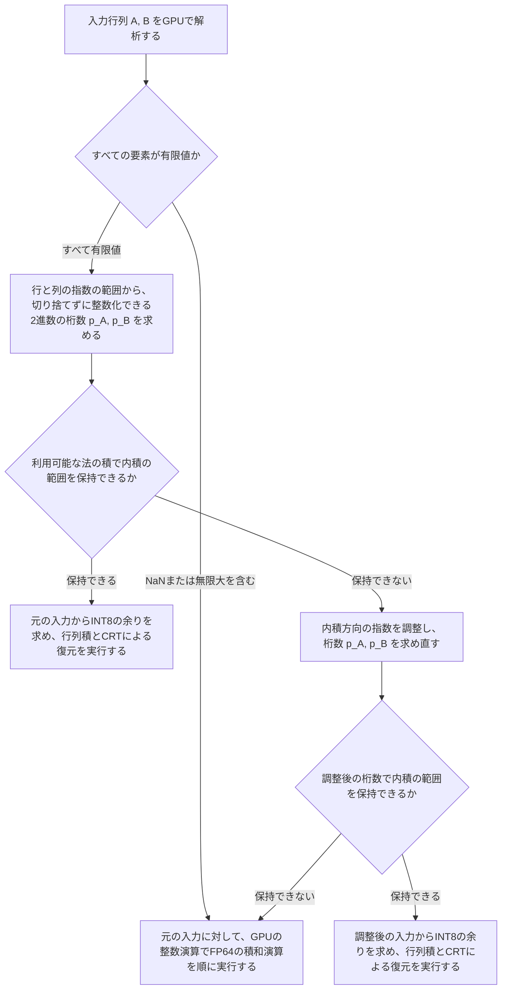

# AppleSilicon-FP64

日本語 | [English](README.en.md)

AppleSilicon-FP64は、Apple SiliconのGPU（Metal）を使って、倍精度浮動小数点数（FP64）で表された密な実数の行列積 $C = AB$ を計算するライブラリーおよび実験用のコマンドラインツールである。

入力の値に依存する数値演算はすべてGPU上で実行する。まずGPUで入力行列の指数の広がりを調べ、すべての要素を誤差なく整数に変換できる場合は、整数の余りを用いたINT8の行列積と、中国剰余定理（CRT）による復元を組み合わせて積を求める。CRTとは、互いに素な複数の除数（「法」と呼ぶ）で割った余りから、一定の範囲にある整数を一意に復元する手法である。一方、指数の広がりが大きすぎてCRTで表現できる範囲を超える場合や、入力にNaN（非数）または無限大が含まれる場合は、GPUの整数演算で実装したFP64の積和演算（FMA）によって内積を計算する。

公開APIとコマンドラインツールはC言語（C11）で記述し、Metalのリソース管理とGPUへのディスパッチはObjective-Cで実装している。C++のプログラムからも、ラッパーを介さずに同じCヘッダーをそのまま利用できる。

## 計算の定義

入力は、FP64の値を行優先で連続して並べた $M \times K$ 行列 $A$ と $K \times N$ 行列 $B$ である。通常の有限値のほか、非正規化数、符号付きゼロ、NaN、無限大を入力できる。また、行数や列数が $0$ の空の行列や、内積の項数が $K = 0$ の入力も受け付ける。一方、定数倍の係数や転置を伴うBLAS形式の操作は対象外である。

ライブラリーが入力行列を解析して計算方式を選び、出力行列 $\widehat{C}$ を求めるまでの流れを次の図に示す。



### 必要な整数幅の算出

まず、NaNと無限大を除いた有限の要素について、FP64のビット列から2のべき乗の指数を取り出す。行列 $A$ の各行 $i$ と行列 $B$ の各列 $j$ について、絶対値の最大値を抑える指数 $h_i$ と $g_j$ を次の式で定める。行または列の要素がすべてゼロである場合、その指数は $0$ とする。

$$
h_i = 1 + \left\lfloor \log_2 \max_k |A_{ik}| \right\rfloor, \qquad
g_j = 1 + \left\lfloor \log_2 \max_k |B_{kj}| \right\rfloor
$$

次に、有限の非ゼロ要素において最下位の非ゼロビットが位置する最小の指数を、行列 $A$ の行ごとに $\ell_i$、行列 $B$ の列ごとに $t_j$ とおく。各行または各列の最大値を基準として、すべての要素を切り捨てずに整数で表すために必要な2進数の桁数を「整数幅」と呼び、$p_A, p_B$ を次の式で定める。行または列の要素がすべてゼロである場合、必要な幅は $1$ とする。この整数幅は、行や列の中での指数の広がりを含めた桁数であり、単一のFP64値が持つ仮数の桁数（53ビット）とは異なる。

$$
p_A = \max_i \max(1, h_i - \ell_i), \qquad
p_B = \max_j \max(1, g_j - t_j)
$$

### 内積方向の指数の調整

すべての要素が有限値であっても、元の行列の整数幅 $p_A, p_B$ が大きく、利用可能な法の積で内積の範囲を保持できない場合がある。しかし、内積の各項 $A_{ik} B_{kj}$ では、$A$ の第 $k$ 列と $B$ の第 $k$ 行に逆向きの2のべき乗を掛けても積の値は変わらない。そこで、元の整数幅では法の積に収まらない場合、内積方向の添字 $k$ ごとに指数を調整して整数幅を求め直す。

調整量 $d_k$ は、$A$ の第 $k$ 列と $B$ の第 $k$ 行における絶対値の最大値から決める。$A$ の第 $k$ 列または $B$ の第 $k$ 行のどちらかがすべてゼロである場合は $d_k = 0$ とする。それ以外の場合は、次の式で指数 $\alpha_k, \beta_k$ と調整量 $d_k$ を定める。

$$
\alpha_k = 1 + \left\lfloor \log_2 \max_i |A_{ik}| \right\rfloor, \qquad
\beta_k = 1 + \left\lfloor \log_2 \max_j |B_{kj}| \right\rfloor
$$

$$
d_k = \left\lfloor \frac{\beta_k - \alpha_k}{2} \right\rfloor, \qquad
\widetilde{A}_{ik} = A_{ik} 2^{d_k}, \qquad
\widetilde{B}_{kj} = B_{kj} 2^{-d_k}
$$

この変換は各項について $\widetilde{A}_{ik} \widetilde{B}_{kj} = A_{ik} B_{kj}$ を満たす。ライブラリーは $\widetilde{A}_{ik}$ と $\widetilde{B}_{kj}$ をFP64へ丸め直すのではなく、整数の指数に $d_k$ を直接加減したうえで、同じ手順によって各行と各列の指数および整数幅 $p_A, p_B$ を求め直す。

### 計算方式の選択と丸めの規則

元の入力、または内積方向の指数を調整した入力のどちらかで、必要な内積の範囲を法の積の中に保持できる場合は、INT8の行列積とCRTによる復元を実行する。この方式では、入力を整数へ変換するときに切り捨ては生じない。出力 $\widehat{C}_{ij}$ は、厳密な内積をFP64へ一度だけ最近接偶数丸め（$\mathrm{RN}_{64}$）した値となる。厳密な内積がゼロになる場合、出力は正のゼロ（$+0.0$）になる。

$$
\widehat{C}_{ij} = \mathrm{RN}_{64}\left(\sum_{k=0}^{K-1} A_{ik} B_{kj}\right)
$$

一方、指数を調整しても必要な整数幅が法の積を超える場合、または入力にNaNや無限大が含まれる場合は、調整前の入力を使い、GPUの整数演算でFP64の積和演算を実行する。内積は初期値 $s_0 = +0.0$ から始め、添字 $k = 0, 1, \dots, K-1$ の順に計算する。各段階では、乗算と加算を合わせた厳密な値を一度だけFP64へ最近接偶数丸めする。

$$
s_{k+1} = \mathrm{RN}_{64}(A_{ik} B_{kj} + s_k), \qquad
\widehat{C}_{ij} = s_K
$$

どちらの計算方式でも、端数の丸めと特殊値は次の規則に従って決定する。

- 非正規化数の範囲に入る値は、正規化数を経由せずにFP64の非正規化数の刻みへ直接丸める。
- 丸めた後の絶対値がFP64の最大の有限値を超える場合は、符号を保った無限大となる。
- 非ゼロの負の値が丸めによってゼロとなる場合は、負のゼロ（$-0.0$）となる。
- NaNを含む積和演算、ゼロと無限大の乗算、および異符号の無限大どうしの加算は、すべてビット列 `0x7ff8000000000000` のQuiet NaN（静かなNaN）を返す。入力されたNaNのペイロードは保持せず、CPUの浮動小数点例外フラグも変化させない。

選ばれた計算方式によって丸めの回数と順序が変わるため、計算結果はCPUの `cblas_dgemm` とビット単位で一致するとは限らない。また、FP64の積和演算が選ばれた場合は積和のステップごとに丸めを行うため、内積全体を最後に1回だけ丸めた値とは一致しない場合がある。

## GPUでの計算

GPUで実行する主な処理と、その実装の方法を次の表に示す。

| 処理 | 実行の方法 |
|---|---|
| 入力の解析 | FP64のビット列から各要素の指数と最下位の非ゼロビットの位置を調べ、必要な整数幅と非有限値の有無を求める。 |
| INT8の余りへの変換 | 各要素の仮数と指数から整数化した値を構成し、各法で割った余りを符号付きINT8で求める。 |
| INT8の行列積 | INT8を入力とし、INT32で部分和を蓄積するMetal 4の `mpp::tensor_ops::matmul2d` を実行する。 |
| CRTによる復元とFP64への丸め | 法ごとの余りから多倍長の整数で厳密な内積を復元し、FP64のビット列へ丸める。 |
| FP64の積和演算 | 仮数の積と加数を128ビットの整数で加減算し、各積和の結果をFP64のビット列へ丸める。 |

### 入力の解析とCPUによる実行指示

GPUのカーネルは、入力された64ビットのFP64値を32ビットの符号なし整数2個として読み込む。まずCPUは、行列 $A$ の行ごとの解析と行列 $B$ の列ごとの解析を同じMetalの計算エンコーダーに記録し、並行して実行させる。行列 $B$ の解析では、隣接するスレッドが隣接する列を読んでメモリーへのアクセスを連続させ、複数のSIMDグループで内積方向を分担する。両方の解析が完了し、メモリーバリアによって書き込み結果が後続のカーネルから見えるようになった後、集計用のカーネルが全体の整数幅 $p_A, p_B$ と非有限値の有無を12バイトの構造体にまとめる。

最初の解析で、すべての要素が有限値であるものの整数幅がCRTの範囲を超えると分かった場合、CPUは指数を調整するためのコマンドバッファーを1回追加で投入する。このコマンドバッファーでは、解析用のバッファーを再利用して $A$ の各列と $B$ の各行における最大の指数を調べ、GPUで内積方向の調整量 $d_k$ を算出する。続けて、同じコマンドバッファーの中で、調整後の指数を使って $A$ の行と $B$ の列の解析結果を更新する。入力行列そのもののビット列は書き換えず、解析と余りへの変換を行う際に整数の指数へ $d_k$ を直接加減する。

CPUは、GPUが出力した12バイトの解析結果だけを受け取り、使用する計算のパイプラインと作業領域の容量を決定する。CRTを使う場合、CPUは入力の具体的な値に依存しないCRTの復元に使う係数と、余りを求めるための表を作成する。CPUが行列の要素を走査したり、内積を計算したりすることはない。すべてのGPUの処理を投入した後、CPUはGPUの完了を待ってから出力を返す。

### 整数剰余による行列積

#### 法の選択と係数の再利用

法には、256以下の互いに素な整数を大きい順（`256, 255, 253, ..., 29` の最大49個）に使う。合成数を法に含めることで、複数の素因数を1回の行列積でまとめて計算できる。法の積 $P = \prod_t m_t$ が次の条件を満たすまで、大きい順から法を追加する。

$$
P > 2K 2^{p_A + p_B}
$$

各法で余りを求めるための係数、2のべき乗の余りの表、およびCRTの復元に使う係数は、内積の項数 $K$ と両方の入力の整数幅 $p_A, p_B$ だけから決まる。そのため、連続する呼び出しで $K, p_A, p_B$ が同じであれば作成済みの係数を再利用し、入力された行列から余りへの変換だけを毎回GPUで実行する。

#### 行のまとまりによる分割と余りへの変換

中間のバッファーが消費するメモリー量を抑えるため、行列 $B$ の余りは全体の分を一度生成して保持し、行列 $A$ の余りと出力は指定された行数（`batch_rows`）のまとまりごとに分割して処理する。

余りへ変換するカーネルでは、使用する法の個数にかかわらず、各要素の仮数と指数への分解を1回だけ行う。行または列における基準の指数に合わせて仮数を右シフトする際、整数幅 $p_A, p_B$ の定義から、シフトによって外へ出る下位ビットはすべてゼロである。また、仮数の上位ワードと下位ワードに掛ける2のべき乗の余りは、両方の8ビット余りを1つの16ビット値に詰めた単一の表から取得する。各法による余りは、逆数の近似値との32ビット乗算の上位ワード（`mulhi`）と最大1回の減算による補正から求め、符号付きINT8の範囲に収まる中心化剰余（対称な余り）へ変換する。

#### INT8の行列積と内積の分割

行列積のカーネルでは、4個のSIMDグループが分担して $64 \times 64$ の出力タイルを計算する。タイル全体が行列の内部に収まり、かつ内積の区間の長さが規定の1024項に一致する場合は、コンパイル時に寸法が定まるテンソルを使う。行列の端にかかるタイルでは、実際の寸法を指定したテンソルを使う。

Metalの `matmul2d` は出力の型がINT32であっても、内部の実行経路でFP32の中間値を使う場合、丸め誤差なく整数を表現できる範囲は $2^{24}$ 以下に限られる。そのため、出力の型がINT32であることだけを根拠に長い内積の整数の精度を仮定せず、各項の絶対値の総和が $1024 \times 128^2 = 2^{24}$ 以下に収まるよう、内積を最大1024項ごとの区間に分割する。この分割によって整数化の指数は変わらない。

- 内積の長さ $K$ が1024以下の場合は、部分内積の配列や加算のループを持たない単一の区間のパイプラインを実行する。
- $K$ が1024を超える場合は、各区間の部分内積をINT32で加算し、符号付きの32ビット整数がオーバーフローしない65536項ごとに法で割った余りへ戻す。最後の区間では、余りの計算と出力のバッファーへの書き込みを同じ反復の中で行う。

また、法256の行列積では、入力の解析結果と整数幅 $p_A, p_B$ から、整数化した各行および各列の要素に共通する下位ゼロビット数の下限を求める。担当するタイルに含まれる $A$ の行の下限の最小値と、$B$ の列の下限の最小値の合計が8以上であれば、内積のすべての項が $2^8 = 256$ の倍数となるため、`matmul2d` の実行を省いて出力タイルへゼロを書き込む。

#### Strassen法によるブロックの積の削減

整数剰余による行列積で次の条件をすべて満たす場合、行列を $2 \times 2$ の4つのブロックに分割し、8個のブロックの積を7個の積で計算するStrassen法を1段適用する。

- $M \ge 1024$ かつ $N \ge 1024$
- $M$ が偶数、$N$ が128の倍数、$K$ が2048の倍数
- 1回に処理する行のまとまりが128行以上

行のまとまりを処理する際は、行列 $A$ の上半分と下半分から同じ行数ずつ取り出し、保持する行数の合計が指定された上限を超えないようにする。Strassen法の入力を生成するカーネルは、FP64からの整数化と、ブロックごとの和や差に対する余りの計算を同じカーネル内で直接行い、分割前の余りの行列を中間のバッファーへ保存しない。内積方向の指数の調整を使う場合は、各ブロックに対応する位置の調整量 $d_k$ を適用する。また、法256での下位ゼロビット数の判定では、和や差を作る両方のブロックを含めて最小値を求める。

7個のブロックの積を計算した後、専用のカーネルで4つの出力ブロックの余りを組み立ててCRTの復元用カーネルへ渡す。ブロックの和と差もすべて法ごとの正確な整数演算で行うため、整数化や最後の丸めの数値的な結果は通常の行列積と変わらない。

#### CRTによる復元とFP64への丸め

CRTによる復元では、各法 $m_t$ について重みの係数 $W_t = (P / m_t)\bigl((P / m_t)^{-1} \bmod m_t\bigr)$ をあらかじめ作成しておく。各出力の要素における余りを $r_t \in [0, m_t)$ とすると、GPUの復元用カーネルは次の総和 $Y$ を基数 $2^{18}$ の多倍長の整数として計算する。

$$
Y = \sum_t r_t W_t
$$

法の個数は最大49個、各余りは255以下であるため、基数 $2^{18}$ の各桁における積和と下位からの繰り上がりは32ビットの符号なし整数に収まる。そのため、桁ごとの積和を他の桁と独立に集計したあと、一度だけ繰り上がりを伝播できる。

次に、$Y$ を法の積 $P$ で割った商 $Y / P$ を、事前に計算した比 $W_t / P$ と余り $r_t$ の積和からFP32で近似し、最も近い整数 $q$ を選ぶ。法が49個以下、余りが255以下の範囲では、FP32の丸めと加算による絶対誤差は $0.1$ 未満に収まる。したがって、多倍長の整数で求めた厳密な差 $Y - qP$ の絶対値は必ず $P$ 未満になる。さらに $|Y - qP| > P / 2$ であれば $P$ を1回だけ加減し、符号付きの厳密な内積を確定する。このように、FP32は商の候補 $q$ を選ぶためにだけ使い、値の復元とFP64への丸めはすべて整数の演算で行う。

復元用のカーネルは、多倍長の整数を格納する配列の容量（18ビット単位で4桁、8桁、12桁、20桁）ごとに別々のパイプラインとしてコンパイルしてある。実行時には必要な桁数を収められる最小のパイプラインを選び、不要な上位桁をGPUのスレッドへ持ち込まないようにしている。

### 整数演算によるFP64の積和演算

CRTを使わない経路では、スレッドグループごとに $16 \times 16$ の出力タイルを分担し、GPUの整数演算でFP64の積和演算を実行する。入力行列のタイルをスレッドグループの共有メモリーへ読み込む際、各要素を符号付きの仮数と指数へ分解する。同じ行や列の出力を計算する複数のスレッドが分解済みの値を共有メモリーから再利用するため、積和のたびに同じ乗数を分解し直す必要がない。内積方向は入力の順序どおりに加算し、末尾の端のタイルでは実際に存在する項だけを加算する。この経路では余りの行列やCRT用の作業領域は使用しない。

また、最初の入力の解析で両方の行列が有限値だけを含むと分かっている場合は、有限値専用のパイプラインを実行し、各積和での乗数に対するNaNと無限大の判定を省く。積和の途中で発生するオーバーフローと非正規化数の丸めは、どちらのパイプラインでも同じように処理する。

1回の積和演算は、次の手順で計算する。

1. 53ビットの仮数どうしの積を、32ビットの部分積と繰り上がりから最大106ビットの厳密な整数として直接求める。加算の前に乗算の結果だけをFP64へ丸めることはない。
2. 乗算の結果と加数の指数を揃え、128ビット（32ビットのワード4個）の整数として加算または減算する。指数を揃えるシフトは64ビット単位、32ビット単位、32ビット未満の移動に分けて実装し、配列を可変の添字で参照する処理を避けている。128ビットの下端より下へはみ出すビットについては、非ゼロのビットが1つでもあるかを最下位ビットへ集約する。
3. 積と加数の符号が同じであれば加算し、異なれば減算する。減算では、最上位のワードからの借り（ボロー）の有無で結果の符号を判定し、借りをビットマスクへ展開して2の補数から絶対値を求めることで、SIMDレーン間の符号の違いによる分岐をなくしている。
4. 128ビットの絶対値からFP64のビット列へ丸める。このとき、ステップ2と同じ指数を揃える関数を使って、保持する53ビットの仮数の直下に2ビットを残す。上の1ビットが丸めの境界（中間値）を判定するビットとなり、下の1ビットがそれより下位の非ゼロの情報をまとめたビットとなる。最近接偶数丸めで加算する `0` または `1` はビット演算で求め、仮数の繰り上がりは整数の大小の比較で判定する。

## 実行環境と資源

ビルドと実行に必要な環境を次に示す。

- ハードウェア: Apple Silicon（`arm64` / `aarch64`）
- OS: macOS 26.0以降
- 開発ツール: Metal Shading Language 4（`-std=metal4.0`）をコンパイルできるXcode、およびCMake（最低バージョンは [CMakeLists.txt](CMakeLists.txt) の `cmake_minimum_required` で定める3.24）
- 検証用のツール: テストを実行する場合に限り、Python 3とC++11コンパイラーを使用する。ライブラリー本体の実装には外部の数値計算用ライブラリーは不要であり、性能比較のコマンドにはmacOS標準のAccelerateフレームワークを使用する。

行列の各次元 $M, N, K$ は、Metalのテンソルが表現できる符号付きの32ビット整数の範囲（`INT_MAX` 以下）とする。メモリー上の作業領域として、入力の行列 $A, B$ と出力の行列 $C$ のFP64バッファー、および行と列の解析結果のバッファーは行列全体の大きさを保持する。内積方向の指数の調整を行う場合は、内積の項数 $K$ と同じ個数の32ビット整数のバッファーを追加で確保し、解析結果のバッファーも各入力の行数と列数の両方を収められる容量まで拡張して再利用する。CRTの中間のバッファーの容量は、選ばれた法の個数と、一度に処理する行のまとまりの大きさ（`batch_rows`）から決まる。一方、FP64の積和演算を使う場合は中間のバッファーを使わないため、`batch_rows` の設定によって作業領域の大きさは変わらない。

引数の不備、CPUのメモリーを確保できない失敗、Metalのバッファーの上限を超える失敗や実行の失敗が起きた場合は、戻り値のステータスで失敗の種類を分類し、診断のメッセージを返す。資源の不足やGPUでの実行の失敗が起きたときに、暗黙にCPUでの計算へ切り替える処理は行わない。

## ビルドと検証

XcodeのMetal Toolchainがまだ導入されていない場合は、ビルドの前にAppleの追加コンポーネントを取得する。

```sh
xcodebuild -downloadComponent MetalToolchain
```

ライブラリー、Metalカーネル（`fp64.metallib`）、実験用のコマンド（`fp64_metal`）、およびテストをビルドして検証を実行する手順を次に示す。

```sh
cmake -S . -B build -DCMAKE_BUILD_TYPE=Release
cmake --build build
ctest --test-dir build --output-on-failure
```

単独でのビルドでは、ライブラリー、コマンド、テストのすべてが既定で構築される。他のプロジェクトから `add_subdirectory` で組み込む場合は、`APPLE_FP64_BUILD_TOOLS` の既定値が `OFF` となり、親プロジェクトで `BUILD_TESTING` が有効であっても本ライブラリーのコマンドとテストは追加されない。ビルドの対象を切り替えるCMakeオプションの組み合わせを次の表に示す。

| ビルドの対象 | 指定するCMakeオプション | C++コンパイラーとPython 3 |
|---|---|---|
| ライブラリー、コマンド、テスト | 指定なし | 必要 |
| ライブラリーとコマンドのみ | `-DBUILD_TESTING=OFF` | 不要 |
| ライブラリーのみ | `-DBUILD_TESTING=OFF -DAPPLE_FP64_BUILD_TOOLS=OFF` | 不要 |

`ctest` では次の5種類の検証を実行する。

1. 有理数による数値の検証（`exact_matrix_products`）: Python標準ライブラリーの `fractions.Fraction` を使い、GPUの出力の全64ビットを独立に計算した期待値と照合する。CRTを使う入力では、指数の調整の有無にかかわらず厳密な有理数の内積を求めて最後に一度だけFP64へ丸める。指数を調整してもCRTの範囲を超える入力や非有限値を含む入力では、積和ごとに厳密な有理数をFP64へ丸める。通常の丸め、偶数丸めの境界、非正規化数、オーバーフロー、桁の打ち消し、NaN、無限大、INT32の部分内積の分割（$K = 131073$）、行や列によって下位ゼロビット数が異なる入力、および指数の調整によって調整後の値がFP64の最小の非正規化数を下回るケースやFP64の範囲を超える積が打ち消し合うケースを検証する。
2. 積和演算の単体での検証（`fused_multiply_add`）: 整数演算によるFP64の積和演算を、すべての指数の範囲と桁の打ち消しを含む2万件の入力についてCPUの `fma` と比較し、全ビットの一致を確認する。
3. 計算器の再利用とStrassen法の検証（`repeated_matrix_products`, `cpp_matrix_product`）: 同じ `apple_fp64_multiplier_t` を使って寸法、一度に処理する行数、および指数の範囲を変えた複数の行列積を実行し、不正な引数や読み込めないMetalライブラリーに対する失敗時の診断も確認する。また、Strassen法が適用される大きな長方形の行列（$1026 \times 1152 \times 2048$）について、上下と左右のブロックで下位ゼロビット数が異なる入力や、内積方向の指数が異なる入力を与え、厳密な整数の期待値と一致することを確かめる。あわせて、C++から公開ヘッダーを読み込んでリンクできることを確認する。
4. ベンチマークの出力結果の検証（`benchmark_measurements`）: `benchmark` サブコマンドが出力した各区間の実行の順序を確認し、区間ごとの測定値から平均の時間、試行ごとの速度比、中央値、最小値と最大値、絶対偏差の中央値を独立に集計して表示された値と照合する。
5. 外部プロジェクトからの導入の検証（`library_consumers`）: CおよびC++の独立したCMakeプロジェクトから、`add_subdirectory` でソースを組み込む方法と、`cmake --install` したパッケージを別のディレクトリーへ移動して `find_package` で読み込む方法の両方で、公開ヘッダーの読み込み、リンク、`fp64.metallib` の取得、および行列積の実行を確認する。

## コマンドの使用方法

ビルドで生成される `fp64_metal` コマンドは、性能を比較する `benchmark` サブコマンドと、バイナリーファイルの行列積を計算する `multiply` サブコマンドを備えている。

### ベンチマークの実行（`benchmark`）

正方行列について、Accelerateの `cblas_dgemm` と `AppleSilicon-FP64` の性能を比較する。引数には行列の次数 $N$ と測定の試行回数を順に指定する（省略したときの既定値は $N = 512$、試行回数 $5$）。

```sh
./build/fp64_metal benchmark 512 5
```

計算器の初期化と測定前の準備実行は、繰り返しの測定から除外する。準備実行では両方の方式を交互に実行し、各方式の累計の実行時間が0.25秒以上になり、かつ各方式を2区間以上実行するまで繰り返す。各区間では同じ入力の行列積を連続して計算し、直近の区間に要した時間から1区間が約0.05秒となる反復回数を方式ごとに決める（1回の行列積に0.05秒以上かかる場合は1回とする）。準備実行が終わった後は反復回数を固定し、本測定の途中で変更しない。

本測定の1試行では、両方の方式を2区間ずつ、合計4区間測定する。実行の順序による偏りを抑えるため、試行の番号の偶奇に応じて区間の順序を入れ替える。試行ごとの各区間の実行順序を次の表に示す。

| 試行 | 第1区間 | 第2区間 | 第3区間 | 第4区間 |
|---|---|---|---|---|
| 奇数回目 | Accelerate | AppleSilicon-FP64 | AppleSilicon-FP64 | Accelerate |
| 偶数回目 | AppleSilicon-FP64 | Accelerate | Accelerate | AppleSilicon-FP64 |

両方の方式とも、呼び出し側の単調に増加する時計（`CLOCK_MONOTONIC`）で1区間全体の経過した時間を測り、区間内の反復回数で割って行列積1回当たりの実時間を求める。

- `AppleSilicon-FP64` の測定には、入力の解析と変換、作業領域と出力の領域の確保、入力のデータのコピー、GPUが完了するまでの待機、および各反復で返された結果の配列を解放する処理（`apple_fp64_result_destroy`）をすべて含める。GPUは呼び出し側へ返す出力用のメモリー領域へ直接書き込む。
- `Accelerate` の測定では、あらかじめ確保した出力の配列をすべての反復で再利用する。

各試行では、方式ごとに2区間の平均の時間を求め、同じ試行における `Accelerate` の平均の時間を `AppleSilicon-FP64` の平均の時間で割った値をその試行の速度比とする。すべての試行を終えると、各区間の測定値を実行した順に出力したうえで、外れ値を除外せずに方式ごとの実時間と試行ごとの速度比の中央値、最小値、および最大値を表示する。また、時間のばらつきの指標として、中央値からの絶対偏差の中央値を時間の中央値で割った百分率も表示する。

内訳として表示される「入力変換」（入力の解析を含む）、「GPUの行列積」、「復元」は、Metalのコマンドバッファーから取得したGPUの実行時間である。CPUの待ち時間はGPUの実行と重なるため、各内訳の合計は全体の実時間とは一致しない。また、末尾に表示される `Accelerateとの最大絶対差` はベンチマークで使った乱数の入力における要素ごとの差の最大値であり、任意の入力に対する精度を保証する値ではない。

### ファイルからの行列積の計算（`multiply`）

任意の寸法の行列積を計算する場合は、ヘッダーを付けずに、リトルエンディアンのIEEE 754 binary64（FP64）形式の値を行優先で並べたバイナリーファイルを入力として渡す。引数は $M, N, K$、入力ファイル `A.bin`、入力ファイル `B.bin`、出力ファイル `C.bin` の順であり、最後の引数（省略可）で一度に処理する行のまとまりの大きさ（`batch_rows`）を指定できる。

```sh
./build/fp64_metal multiply 128 96 64 A.bin B.bin C.bin 256
```

ファイルの読み込みはCPUで行う。有限値のほか、NaNや無限大を含むファイルも入力できる。入力ファイルのバイト数が $M \times K \times 8$ または $K \times N \times 8$ と一致しない場合や、計算に失敗した場合は、理由を標準エラー出力へ書き出して終了コード `1` で終了する。計算が正常に完了するまで、出力ファイル `C.bin` は開かない。

## 計測結果と性能

`benchmark` サブコマンドによる測定の条件を次の表に示す。

| 項目 | 条件 |
|---|---|
| チップ | Apple M3 Max。CPUは16コア、GPUは40コア。 |
| メモリー | 128 GB。 |
| OS | macOS 27.0（26A428）。 |
| 開発環境とビルド | Xcode 27.0（27A266a）、Release。 |
| 電源 | AC電源。 |
| 実行時の設定 | Accelerateのスレッド数とMetalの検証を指定する環境変数は未設定。 |
| 並行する処理 | OSのバックグラウンドの処理とデスクトップアプリケーションが動作する環境。 |
| 入力 | 乱数の種は `123`。区間 $[-1, 1)$ の一様分布から生成したFP64の正方行列を使う。 |
| 整数幅 | 入力から自動で決定する。 |
| 行のまとまりの大きさ | 256行。 |

各次数 $N$ について、プロセスを分けて7試行の測定を3組（合計21試行）実行した。各表の代表値は全21試行の中央値であり、括弧内は全21試行の最小値と最大値である。外れ値は除外していない。なお、最小値と最大値は各試行における平均の時間の範囲であり、1回の呼び出しの遅延の範囲ではない。この測定を再現するコマンドを次に示す。

```sh
for series in 1 2 3; do
    for n in 128 256 512 1024 2048 4096 8192; do
        ./build/fp64_metal benchmark "$n" 7
    done
done
```

通常の入力の測定において、Metalの初期化に要した時間は 28.0～46.3 ms であった。

速度比は試行ごとに算出した比の中央値であるため、2つの方式における時間の中央値どうしの比とは一般には一致しない。速度比が `1` を超える次数では `AppleSilicon-FP64` の方が速い。実効GFLOP/sは、次数 $N$ の正方行列積における浮動小数点の演算数を $2N^3$ として、全体の実時間の中央値から換算した値である。通常の入力における全体の実時間、速度比、および `AppleSilicon-FP64` の実効性能を次の表に示す。

| 次数 | Accelerate（ms） | AppleSilicon-FP64（ms） | 速度比 | AppleSilicon-FP64の実効GFLOP/s |
|---:|---:|---:|---:|---:|
| 128 | 0.0132（0.0130～0.0137） | 0.5675（0.4999～0.6400） | 0.023（0.020～0.026） | 7.4 |
| 256 | 0.0896（0.0868～0.0927） | 0.7198（0.6399～0.9237） | 0.123（0.098～0.137） | 46.6 |
| 512 | 0.3840（0.3810～0.4005） | 1.3473（1.2334～1.5448） | 0.288（0.247～0.309） | 199.2 |
| 1024 | 2.9435（2.8911～3.0256） | 4.6256（4.4305～4.8140） | 0.640（0.602～0.667） | 464.3 |
| 2048 | 23.6977（23.5078～24.4395） | 24.9748（24.6720～25.7605） | 0.950（0.927～0.983） | 687.9 |
| 4096 | 192.5540（188.0395～196.9010） | 173.3290（170.8985～175.3040） | 1.112（1.092～1.132） | 792.9 |
| 8192 | 1534.8580（1514.8270～1583.9300） | 1337.1440（1300.7025～1369.6780） | 1.152（1.119～1.171） | 822.3 |

中央値からの絶対偏差の中央値の百分率は、少数の大きな変動の影響を受けにくいため、全体の実時間の表に示した最小値および最大値とあわせて確認する。全21試行における時間のばらつきを次の表に示す。

| 次数 | Accelerateの絶対偏差の中央値（%） | AppleSilicon-FP64の絶対偏差の中央値（%） |
|---:|---:|---:|
| 128 | 0.711 | 5.788 |
| 256 | 1.143 | 5.085 |
| 512 | 0.611 | 5.229 |
| 1024 | 0.611 | 1.976 |
| 2048 | 0.472 | 0.594 |
| 4096 | 0.703 | 0.607 |
| 8192 | 0.434 | 1.152 |

Metalの作業領域はGPUでの計算に使用したMetalバッファーの容量の合計であり、CPU側の入力配列などは別にメモリーを消費する。GPUでの各段階の処理時間（全21試行の中央値）、使用した法の個数、およびMetalの作業領域の容量を次の表に示す。

| 次数 | 入力変換（ms） | GPUの行列積（ms） | 復元（ms） | 法の個数 | Metalの作業領域（MiB） |
|---:|---:|---:|---:|---:|---:|
| 128 | 0.063 | 0.030 | 0.018 | 15 | 1.119 |
| 256 | 0.131 | 0.086 | 0.030 | 15 | 4.357 |
| 512 | 0.387 | 0.423 | 0.125 | 15 | 13.550 |
| 1024 | 1.223 | 2.652 | 0.465 | 15 | 46.562 |
| 2048 | 2.727 | 19.121 | 2.699 | 16 | 244.085 |
| 4096 | 7.584 | 152.796 | 10.663 | 16 | 904.132 |
| 8192 | 38.097 | 1219.881 | 41.564 | 16 | 3472.226 |

この通常の入力の測定において観測された `Accelerate` との差の絶対値の最大値は、全次数を通じて `1.492e-12` であった。

### 広い指数範囲の入力

次に、内積方向で指数の変化が相殺される広い指数範囲の入力を測定した。通常の入力と同じ乱数で生成した行列に対し、偶数の $k$ では $A$ の第 $k$ 列を $2^{-500}$ 倍、$B$ の第 $k$ 行を $2^{500}$ 倍し、奇数の $k$ では倍率を逆（$2^{500}$ 倍と $2^{-500}$ 倍）にする。各項の積 $A_{ik} B_{kj}$ では指数の倍率が打ち消し合うため、結果の大きさを変えずに入力の行列の指数範囲だけを広げることができる。さらに、要素の符号による影響も調べるため、512次以上では乱数の要素をすべて絶対値にして非負に変えてから同じ指数の変換を施した入力も測定した。

これらの入力を公開C APIへ渡し、「コマンドの使用方法」と同じ準備実行、反復回数の決定、区間の順序、集計の方法で7試行を3組（全21試行）測定した。すべての条件で、内積方向の指数の調整によってCRTによる計算が選ばれた。なお、「GPUの行列積」は行列積のカーネル自体のGPU実行時間であり、入力の変換と復元の時間は含まない。内積方向で指数が相殺される入力についての全21試行の中央値と範囲を次の表に示す。

| 次数 | 入力の符号 | Accelerate（ms） | AppleSilicon-FP64（ms） | GPUの行列積（ms） | 法の個数 | AppleSilicon-FP64の絶対偏差の中央値（%） | Metalの作業領域（MiB） |
|---:|---|---:|---:|---:|---:|---:|---:|
| 32 | 正負が混在 | 0.000520（0.000518～0.000549） | 0.749960（0.646867～0.846608） | 0.018 | 15 | 6.181 | 0.114 |
| 64 | 正負が混在 | 0.002129（0.002116～0.002548） | 0.804655（0.664664～0.874804） | 0.025 | 15 | 3.935 | 0.310 |
| 128 | 正負が混在 | 0.013319（0.013270～0.014881） | 0.836678（0.726169～0.886571） | 0.027 | 15 | 1.874 | 1.120 |
| 512 | 正負が混在 | 0.383215（0.380586～0.389694） | 1.786138（1.610000～2.011351） | 0.431 | 15 | 4.709 | 13.552 |
| 512 | 非負 | 0.383350（0.379599～0.387721） | 1.729391（1.450906～1.993316） | 0.432 | 15 | 6.203 | 13.552 |
| 1024 | 正負が混在 | 2.966559（2.936794～3.204647） | 5.261150（5.129150～5.457150） | 2.659 | 15 | 1.396 | 46.566 |
| 1024 | 非負 | 2.951970（2.895000～3.147028） | 5.241000（4.943091～5.470100） | 2.658 | 15 | 1.964 | 46.566 |
| 2048 | 正負が混在 | 23.728500（23.554333～24.348334） | 26.109500（25.694000～27.047750） | 19.154 | 16 | 0.431 | 244.093 |
| 2048 | 非負 | 23.599500（23.347333～24.261834） | 26.144250（25.449250～26.840500） | 19.106 | 16 | 0.731 | 244.093 |
| 4096 | 正負が混在 | 194.341000（189.743000～213.096500） | 176.196500（175.222500～177.843500） | 152.970 | 16 | 0.295 | 904.148 |
| 4096 | 非負 | 191.328000（187.696000～196.124500） | 175.896500（173.647500～177.203000） | 152.514 | 16 | 0.428 | 904.148 |
| 8192 | 正負が混在 | 1538.281500（1511.738500～1694.330500） | 1356.759500（1307.479000～1777.079000） | 1225.263 | 16 | 1.966 | 3472.257 |
| 8192 | 非負 | 1534.375000（1519.494000～1541.803500） | 1342.934500（1311.778500～1390.592000） | 1224.072 | 16 | 1.198 | 3472.257 |

この測定の入力における `Accelerate` との差の絶対値の最大値は、正負が混在する入力で `1.492e-12`、非負の入力で `2.501e-11` であった。

一方、内積方向の指数を調整しても整数幅が狭まらない例として、行方向と列方向の両方で指数が交互に変わる1024次の正方行列も測定した。0から数えた行番号と列番号の和が偶数の位置では $A$ の要素を $2^{-500}$ 倍、$B$ の要素を $2^{500}$ 倍し、奇数の位置では倍率を逆にする。この変換では $A$ の各列と $B$ の各行の中に $2^{-500}$ 倍の要素と $2^{500}$ 倍の要素が混在するため、内積方向の指数を調整しても整数幅は縮まらない。

正負が混在する同じ乱数の入力を使い、7試行を3組（全21試行）測定した。表の「入力解析」には、指数の調整と再解析の時間も含まれる。この入力では法の個数が `0` となり、整数演算によるFP64の積和演算が実行された。行方向と列方向の両方で指数が交互に変わる1024次の行列についての測定結果を次の表に示す。

| 次数 | Accelerate（ms） | AppleSilicon-FP64（ms） | 入力解析（ms） | GPUの積和演算（ms） | AppleSilicon-FP64の絶対偏差の中央値（%） | Metalの作業領域（MiB） |
|---:|---:|---:|---:|---:|---:|---:|
| 1024 | 2.959889（2.899500～3.062088） | 49.129750（48.067250～50.277250） | 0.353 | 47.206 | 0.913 | 24.027 |

この入力における `Accelerate` との差の絶対値の最大値は `0` であった。

### 考察

#### 行列の大きさと比較結果

通常の乱数の入力では、2048次までの行列において全21試行で `Accelerate` の方が速く、4096次と8192次では全21試行で `AppleSilicon-FP64` の方が速い。

一般に、正方行列の次数を2倍にすると通常の行列積の演算量は8倍になる。一方、`AppleSilicon-FP64` の全体の実時間は、2048次から4096次で約6.94倍、4096次から8192次で約7.71倍の増加に抑えられている。2048次以上の測定では「整数剰余による行列積」で説明したStrassen法が働く。ただし、次数によって使用する法の個数も変化するため、異なる次数の測定結果の比だけからStrassen法単体の高速化率を切り出すことはできない。

なお、各表の時間は作成済みの計算器（`apple_fp64_multiplier_t`）を再利用してAPIを呼び出した場合の実時間である。呼び出しのたびに計算器を作成する場合は、Metalの初期化に要する時間（28.0～46.3 ms）が加わる。また、`Accelerate` は呼び出し側が確保した出力配列を再利用するのに対し、`AppleSilicon-FP64` は呼び出しごとに出力領域の確保と解放を含めて測定しているため、両方のAPIが1回の呼び出しで行う処理の範囲は同一ではない。

#### 入力の解析と小さい行列

入力の情報を切り捨てない整数幅を決めるため、`AppleSilicon-FP64` はAPIを呼び出すたびにGPUで入力を解析し、CPUがその解析結果を受け取ってから計算のパイプラインを選ぶ。仮にこの解析を省略すると、同じ計算器へ指数の範囲が異なる行列を渡したときに小さい項の情報が失われるおそれがある。

128次の測定では、GPUの各段階における処理時間（中央値）の合計は全体の実時間（中央値）の約19%にとどまる。演算量が小さい領域では、GPUでの計算そのものよりも、コマンドの記録と投入、CPUとGPUの間の同期、および出力領域の確保や解放にかかる固定費用の割合が大きいと考えられる。なお、内訳の中央値と全体の実時間の中央値は同じ試行から得られた値とは限らないため、両者の単純な差をそのままCPUの処理時間とみなすことはできない。

#### 大きい行列の処理とメモリー

8192次の測定では、GPUの処理時間の中央値の合計のうち、INT8の行列積が約94%を占める。したがって、大きい行列での実効性能は、必要な個数の法に対する行列積をいかに効率よく処理できるかに強く依存する。整数幅は入力から動的に決まるため、必要な法の個数も入力の値によって変化する。

また、Metalの作業領域は4096次から8192次で約3.84倍に増えている。入力 $A, B$ と出力 $C$ のFP64バッファー、および $B$ の余りの配列は行列全体について保持する必要がある。そのため、行のまとまり（`batch_rows`）を小さくしても、全体のメモリー使用量が同じ比率で減るわけではない。さらに `batch_rows` を128未満に下げるとStrassen法の適用条件から外れるため、`batch_rows` を調整する際は実行の時間とメモリー容量の両方を実測して判断する必要がある。

#### 精度と測定範囲

通常の乱数の入力と、内積方向で指数が相殺される入力ではCRTが選ばれ、入力の整数化による切り捨ては一切生じない。これらの入力で `Accelerate` との間に生じるわずかな差は、内積の途中で丸めを繰り返すか、厳密な内積を最後に一度だけ丸めるかという丸めの回数と順序の違いによるものである。

一方、指数の調整を行ってもCRTの範囲に収まらない入力では、FP64の積和演算が選ばれる。この方式は積和ごとに丸めを行うため、計算の途中で大きな桁の打ち消しが起きると相対誤差が大きくなる場合がある。したがって、CRTが選ばれた通常の乱数の入力での差の小ささを、そのままあらゆる指数の範囲に対する精度の根拠とすることはできない。

#### 広い指数範囲での性能

入力の行列全体の指数の範囲が広くても、内積方向で $A$ と $B$ の指数の変化が相殺される構造であれば、指数の調整によって損失なく整数化できる幅まで縮小し、高速なINT8の行列積とCRTを利用できる。実際に測定した入力でも、通常の入力と同じ個数（15個または16個）の法で計算でき、大きい行列での処理時間も通常の入力に近い値となった。

指数が相殺される4096次と8192次の測定では、試行ごとの速度比の中央値で `AppleSilicon-FP64` が `Accelerate` より約1.09～1.14倍速い。ただし、8192次の正負が混在する入力では、一部の試行で `Accelerate` より遅くなるケース（最大値 1777.079 ms）も観測されたため、性能を見積もる際は中央値だけでなく最小値から最大値までの範囲も考慮する必要がある。

なお、指数の調整を行う場合は、追加の解析とCPUおよびGPUの間の同期が1回増える。そのため、演算量が小さい行列ではこの追加の費用の割合が大きくなる。また、行方向と列方向の両方で指数が変化し、指数の調整を行ってもCRTの範囲に収まらない入力（1024次の指数が交互に変わる入力など）では、再解析の費用を払ったうえでFP64の積和演算を実行することになるため、指数の調整による高速化は得られない。

メモリーの使用量についても、指数の調整の後にCRTが選ばれるかFP64の積和演算が選ばれるかによって必要な作業領域が大きく異なる。指数の調整に使う配列の容量（$4K$ バイト）だけでなく、選ばれる計算方式と法の個数をあわせて確認する必要がある。この節に示した測定値はすべて、記載したハードウェアと入力の条件における結果であり、異なるGPUや入力の分布での性能は個別に測定する必要がある。

## CとC++からの使用方法

公開する型、入力と出力の前提条件、メモリーの所有権、および失敗時の動作は `include/apple_fp64/matmul.h` で定義している。このヘッダーはC++から読み込まれた場合に自動で `extern "C"` を適用するため、C++用の追加のラッパーなしでそのまま呼び出せる。

ヘッダー内のDoxygenコメントには日本語と英語の両方の説明を記述してある。[Doxygenの言語を切り替える機能](https://www.doxygen.nl/manual/commands.html#cmdtilde)を使い、Doxygenの設定で `OUTPUT_LANGUAGE` を `Japanese` または `English` に指定すると、選んだ言語の説明を出力できる。

計算器を表す `apple_fp64_multiplier_t` は、コンパイル済みのMetalパイプラインと作業領域のバッファーを内部で保持する。複数の行列積で同じ計算器を再利用でき、既存の作業領域では容量が足りない場合だけ新しいバッファーを確保し直す。

次の例は、CとC++のどちらでもそのままコンパイルできる。

```c
#include <apple_fp64/matmul.h>
#include <stdio.h>

int main(int argc, char **argv)
{
    if (argc != 2) {
        fprintf(stderr, "使用方法: %s /path/to/fp64.metallib\n", argv[0]);
        return 1;
    }
    const double a[] = {1, 2, 3, 4};
    const double b[] = {5, 6, 7, 8};
    apple_fp64_multiplier_t *multiplier = NULL;
    apple_fp64_result_t result = {0};
    apple_fp64_error_t error = {0};
    apple_fp64_status_t status = apple_fp64_multiplier_create(argv[1], &multiplier, &error);
    if (status == APPLE_FP64_SUCCESS) {
        status = apple_fp64_multiply(multiplier, a, 4, b, 4, 2, 2, 2,
                                     apple_fp64_default_options(), &result, &error);
    }
    if (status == APPLE_FP64_SUCCESS) {
        printf("%g %g %g %g\n", result.values[0], result.values[1], result.values[2], result.values[3]);
    } else {
        fprintf(stderr, "%s\n", error.message != NULL ? error.message : "CPUのメモリーを確保できません。");
    }
    apple_fp64_result_destroy(&result);
    apple_fp64_error_destroy(&error);
    apple_fp64_multiplier_destroy(multiplier);
    return status == APPLE_FP64_SUCCESS ? 0 : 1;
}
```

### ソースから組み込む

利用側のプロジェクトの `CMakeLists.txt` で、本リポジトリーのソースのディレクトリーを `add_subdirectory` で追加する。

```cmake
add_subdirectory(path/to/AppleSilicon-FP64 apple-fp64)
```

この方法では、静的ライブラリーとMetalカーネル（`fp64.metallib`）だけが既定でビルドされる。利用側のプロジェクトがC言語だけで書かれていれば、C++コンパイラーやPython 3を用意する必要はない。

### インストールして利用する

「ビルドと検証」の手順でビルドした成果物を、任意のディレクトリーへインストールして利用することもできる。

```sh
cmake --install build --prefix /path/to/apple-fp64
```

インストール先には、静的ライブラリー、公開ヘッダー、`fp64.metallib`、CMakeのパッケージ設定ファイル、および `LICENSE` が配置される（実験用のコマンドとテストはインストールされない）。インストール後のディレクトリーは、全体を別の場所へ移動してもそのまま利用できる。

利用側の `CMakeLists.txt` では `find_package` でパッケージを読み込む。

```cmake
find_package(AppleSiliconFP64 CONFIG REQUIRED)
```

利用側のプロジェクトをCMakeで構成する際、インストール先（移動した場合は移動先）のパスを `CMAKE_PREFIX_PATH` に指定する。

```sh
cmake -S . -B build -DCMAKE_PREFIX_PATH=/path/to/apple-fp64
```

### リンクとMetalファイルの配置

ソースから組み込む方法とパッケージをインストールする方法のどちらでも、利用側のターゲットには `AppleSiliconFP64::apple_fp64` をリンクする。公開ヘッダーの検索パスや、`Metal` および `Foundation` フレームワークのリンクの設定はこのターゲットから自動的に伝わる。また、CMake変数 `AppleSiliconFP64_METALLIB` には、ビルド時またはインストールされた `fp64.metallib` の絶対パスが入る。

コマンドラインのアプリケーションで、実行ファイルと同じディレクトリーへ `fp64.metallib` を複製する `CMakeLists.txt` の例を次に示す。

```cmake
add_executable(my_app main.c)
target_link_libraries(my_app PRIVATE AppleSiliconFP64::apple_fp64)
add_custom_command(TARGET my_app POST_BUILD
    COMMAND ${CMAKE_COMMAND} -E copy_if_different
        "${AppleSiliconFP64_METALLIB}"
        "$<TARGET_FILE_DIR:my_app>/fp64.metallib"
    VERBATIM)
```

macOSのアプリケーションのバンドル（`.app`）に組み込む場合は、`fp64.metallib` をバンドルの資源として同梱し、実行時にバンドル内のパスを取得して `apple_fp64_multiplier_create` へ渡す。ライブラリーは `fp64.metallib` を自動で検索しないため、実行時の作業ディレクトリーに依存しないパスを指定する。

## ライセンス

利用条件は [LICENSE](LICENSE) で定める。

## 参考資料

数値計算の理論的な背景は、[尾崎スキームIIの原論文](https://arxiv.org/abs/2504.08009)に基づいている。多倍長の整数によるCRTの復元と、FP64のビット列を直接組み立てる処理は、Apple SiliconのGPU向けに設計したものである。また、MetalでのINT8の行列積には、[AppleによるMetal 4の解説](https://developer.apple.com/documentation/metal/running-inline-ml-operations-in-a-shader-with-metal-4)およびXcode SDKの `MPPTensorOpsMatMul2d.h` で定義された整数型の組み合わせを使用している。
